# Prusa MK2 Dolly · Bear X axis & extruder

**Operator guide** · [Quick start](#quick-start) · [LCD photo guide](#lcd-photo-guide) · [Filament](#filament) · [Printing](#start-a-print) · [Cooldown](#finish-and-cool-down) · [Troubleshooting](#troubleshooting)

This DIY Prusa MK2 “Dolly” clone has a Bear-style X axis and direct-drive extruder. It uses customized Marlin firmware. Follow this machine's menus and supplied slicer profiles; stock MK2/MK3S instructions may differ.

<em>The spool enclosure is on the left; the control knob is at the front.</em>

## Quick start

1. Check that the build plate is seated, bed is clear, nozzle is clean, filament feeds freely, and nothing obstructs moving parts.
2. Power on. Check for plausible room-temperature readings and no sensor errors before heating.
3. [Load filament](#load-filament) if needed. In OrcaSlicer select the matching printer, filament, and process presets.
4. Slice, inspect the preview and first layer, then export `.gcode` to removable media.
5. Insert the media, select the file under **Print from Media** or **USB Disk**, and [watch startup and the first layer](#start-a-print).
6. At the end, [cool the printer](#finish-and-cool-down) before removing the part.

## Know the controls

Turn the blue knob to move the `>` cursor. Press the knob to open the highlighted item. Select **Back** to return one level. Start from the **Info Screen** (the temperature/status display); press the knob once to open **Main**. If you are already in a menu, select **Back** until you reach Main. Menu positions can shift with the firmware and inserted media, so follow the item names rather than counting knob clicks.

The [short extruder video](media/video_2026-11-07_12-21-34.mp4) shows the head area. The filament entry path and release mechanism should be checked on the physical machine.

## LCD photo guide

### Preheat PETG End: nozzle only

Use **Preheat PETG End** for loading or unloading PETG without heating the bed. In the photographed firmware, **End** means *hotend/nozzle*. The PETG preset targets **230 °C**; check the filament spool before using it.

| Step | Screen | What to do |
| --- | --- | --- |
| 1 | 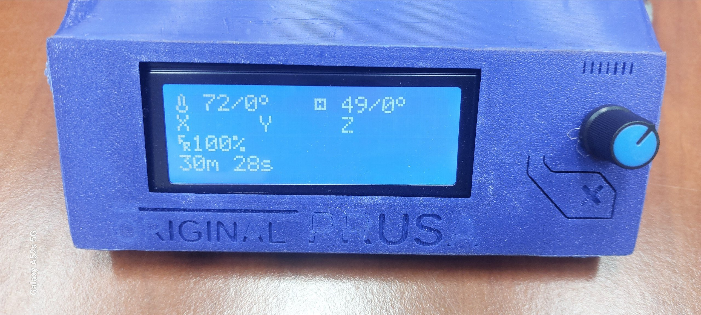 | From the **Info Screen**, press the knob to open **Main**. The nozzle and bed readings are shown as current/target. |
| 2 | 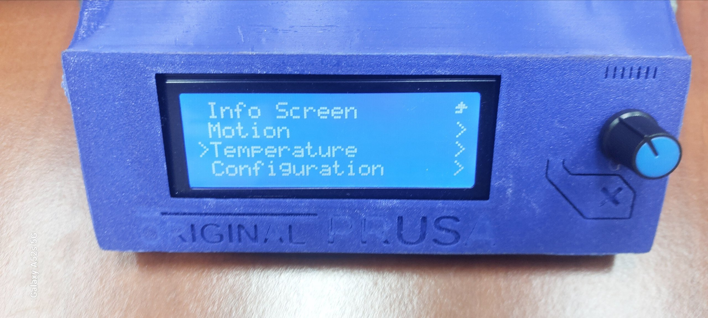 | Turn until `>Temperature` is highlighted, then press. |
| 3 | 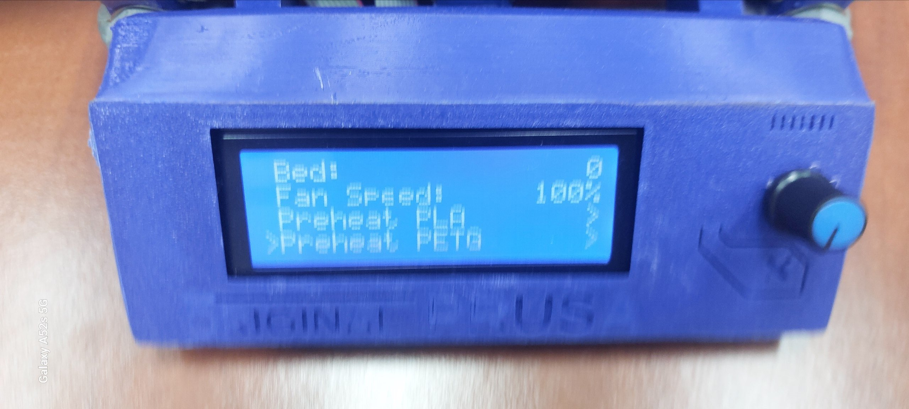 | Scroll to **Preheat PETG** and press to open its submenu. This screen also offers **Preheat PLA**. |
| 4 | 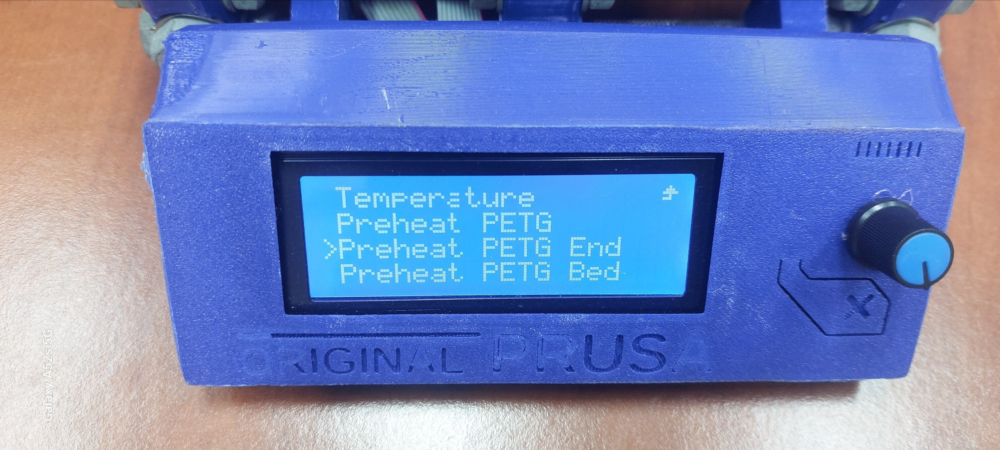 | Select **Preheat PETG End**. **Preheat PETG** heats nozzle *and* bed; **Preheat PETG Bed** heats only the bed. |
| 5 | 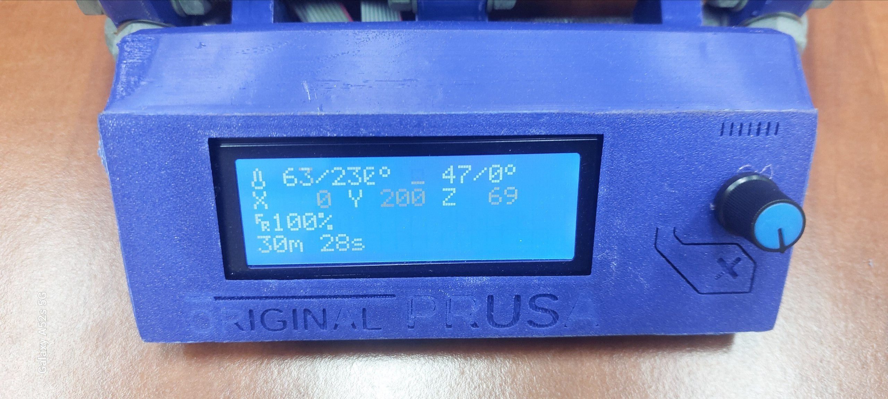 | Watch the status screen. In this example the nozzle is warming toward **230 °C**, while the bed target stays **0 °C**. |
| 6 | 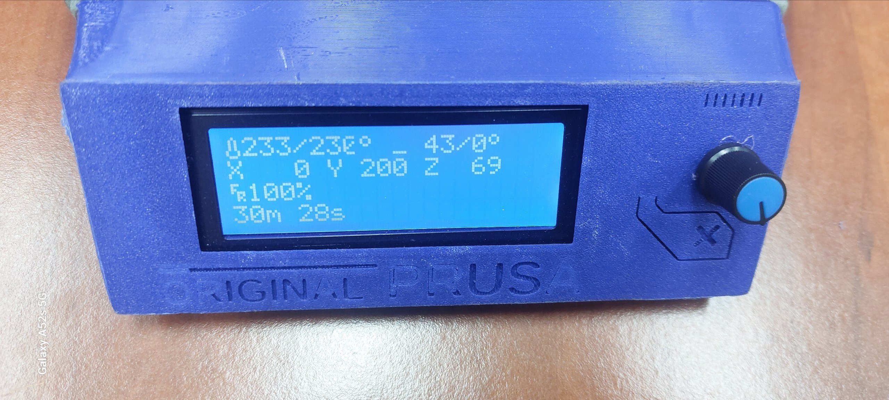 | Wait until the current nozzle temperature reaches the target before feeding or retracting PETG. The bed remains off. |

For a print that needs bed heat, choose **Preheat PETG** at step 4. Use **Preheat PETG Bed** when only the bed should be heated. Complete the same steps but replace **Preheat PETG** with **Preheat PLA** and **Preheat PETG End/Bed** with **Preheat PLA End/Bed**.

### Cooldown: turn off heater targets

> [!IMPORTANT]
> **Always** run this step before powering off the printer. Keep the hotend fan running while the nozzle cools below **50 °C**; turning the printer off while it is hotter can cause a clog.

| Step | Screen | What to do |
| --- | --- | --- |
| 1 |  | From **Main**, select **Temperature**. |
| 2 | 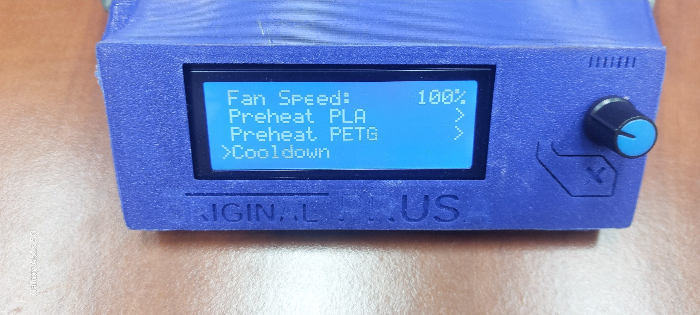 | Scroll past the preheat entries to `>Cooldown` and press. |
| 3 |  | Return to **Info Screen** and verify both target values are `0°`. The current temperatures will take time to fall. |

### Open a G-code file from USB or SD

| Step | Screen | What to do |
| --- | --- | --- |
| 1 | 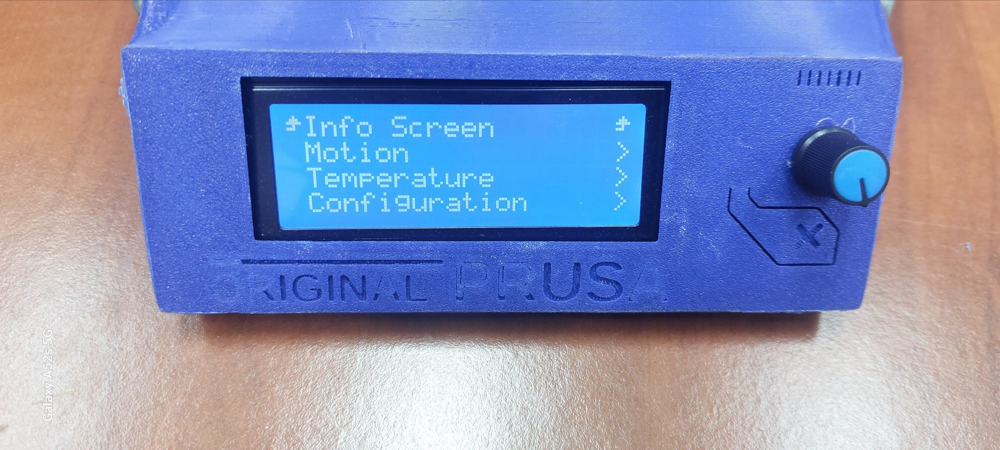 | From **Info Screen**, press the knob to open **Main**. Insert the media with the exported `.gcode` file. |
| 2 | 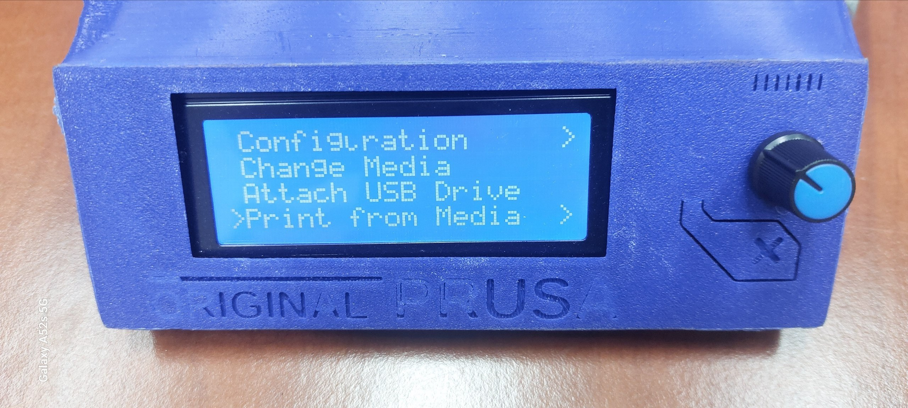 | Scroll to **Print from Media** and press. **Change Media** or **Attach USB Drive** can refresh an unavailable device. |
| 3 | 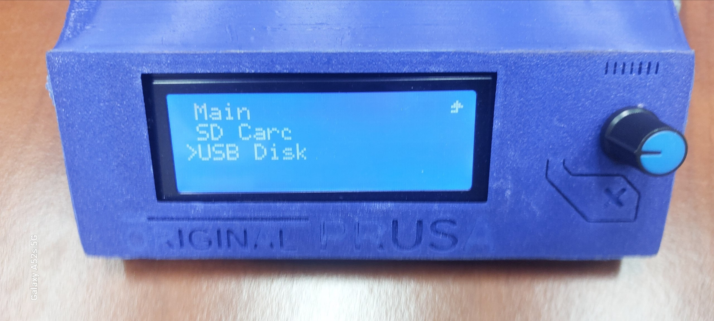 | Choose the device that holds the file: **USB Disk** or **SD Card**. |
| 4 | 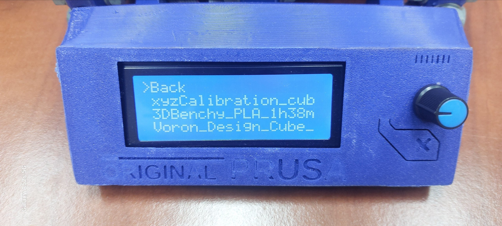 | Scroll through the filenames, highlight the intended `.gcode`, and press to start. **Back** returns without starting a print. |

The photographed file list contains test files. Confirm your own filename before pressing the knob. Then stay at the printer for homing, probing, the purge line, and the first layer.

## Filament

### Load filament

1. Make sure the spool turns freely and the strand is not trapped under a loop. Cut a clean, pointed end; hold the loose strand so the spool cannot unwind.
2. Follow the [Preheat PETG End steps](#preheat-petg-end-nozzle-only), or the corresponding PLA **End** option, to heat only the nozzle for the material being loaded. Wait for the temperature to reach the preset target (230 °C for PETG or 190 °C for PLA). The bed need not be heated just to load filament.
3. Guide the cut end into the extruder inlet and **push firmly**. You should feel the spring-loaded extruder idlers grip the filament and exert some backpressure. *This is normal.*
4. Continue pushing the filament through until it starts to **ooze out** of the nozzle. Then stop.
5. Proceed to the print, or select **Temperature → Cooldown** if finished.

> [!NOTE]
> A **Change Filament** utility exists in the Marlin LCD menu, but I prefer not to use it because it occasionally fails with some filament. The extruder motor also feeds more slowly than a manual push. In my experience, moving the filament quickly when loading or unloading reduces the chance of a jam.

### Unload or change filament

There are two common reasons to change filament:

1. The print has finished, and you want to unload the filament for storage.
2. The filament runs out midway through a print. This printer has a runout sensor and a routine that pauses the print when the sensor detects an empty spool.

The steps below cover **unloading after a finished print**.

1. Finish or pause the print. Do not pull filament out while the machine is printing.
2. Heat the nozzle for the **material currently inside it** and wait until the current temperature reaches the target.
3. **Ensure that motors are disabled**. You can easily test this by lightly pushing the bed. If it can move forwards and backwards, the motors are disabled.
   **Otherwise**, use **Motion → Disable Steppers** on the LCD (the `M84` G-code command).
4. Pull the released strand through the inlet, trim the swollen tip, and secure the spool end. [Load the replacement](#load-filament), or select **Temperature → Cooldown**.

   
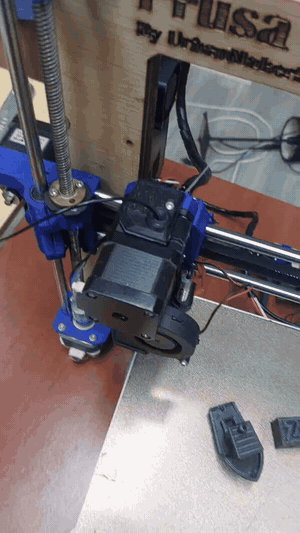

   
<em>Filament removal at the extruder · <a href="media/pull%20filament%20out.mp4">Watch the original MP4</a></em>

> [!IMPORTANT]
> If the filament does not budge, check that the **motors are disabled** and the nozzle is hot enough for the loaded material. Push down firmly until a little filament oozes out, then pull it out quickly. You can also try the **Change Filament** utility on the LCD.

5. **Wait** until the nozzle has cooled below **50 °C** before switching off the machine, so the hotend fan can keep cooling the heatsink.

## Setup OrcaSlicer

### Import printer and filament presets

1. [Download the OrcaSlicer printer profile](OrcaSlicer%20Profiles/Prusa%20MK3S%200.4%20nozzle.orca_printer) from this GitHub repository.
2. Import the `.orca_printer` file into OrcaSlicer as shown:

   

3. Select it from the printer dropdown in OrcaSlicer.

   

4. Select the appropriate filament from the preset library.

   

> [!NOTE]
> The preset locations in these screenshots differ because some filament names conflicted on my original machine and were not imported. On your machine, look for them under the preset bundle subfolder.

## Start a print

### Prepare the bed and file

1. Check that the build surface is seated and free of scraps. Clean it according to that surface's instructions; check before using a scraper or solvent.
2. Choose the filament preset for the loaded spool. Orient the model, add supports or a brim if needed, slice, and inspect the preview for off-bed geometry, missing supports, and the first layer.
3. Remove the USB Drive from the back of the printer (it is a long stick, super obvious!) and insert it into your PC.
4. Export `.gcode`, safely eject the drive from the computer, and insert it back into the printer (the same way you removed it).
5. Use **Change Media** or **Attach USB Drive** if the file list does not refresh.

> [!NOTE]
> This guide covers the operation of **this printer**. For general OrcaSlicer instructions, including slicing `.stl` or `.3mf` models into `.gcode`, consult an OrcaSlicer guide.

### First layer monitoring

1. Follow the [USB/SD photo path](#open-a-g-code-file-from-usb-or-sd). Highlight the intended `.gcode` and press the knob. Confirm the filename.
2. Stay with the machine during startup. The supplied profile heats the bed, homes the axes, aligns independent Z steppers, probes a new bed mesh, heats the nozzle fully, and draws a purge line. Keep hands and tools clear.
3. Watch the entire first layer. Lines should stick and meet cleanly, without loose round strands or the nozzle ploughing into the bed. If it looks wrong, **pause or stop** and correct the cause. Make any available live Z adjustment only in small steps while watching the result.

   Use these images to compare good and poor first layers:

   

   

4. Check periodically that filament feeds freely and the part remains attached. Stay nearby during the first run of an unfamiliar setup.

### Pause, resume, or stop

- **Pause:** Select **Pause Print** on the active print screen. Wait for motion to stop before approaching the head. Select **Resume Print** and watch the next few lines.
- **Filament runout/change:** The source configuration enables a runout sensor and advanced pause. If prompted, follow the LCD, purge until the new material flows cleanly, remove the purge strand, and resume. Verify the sensor on the physical machine before relying on it.
- **Stop:** Select **Stop Print** / **Cancel Print** for a failing print or wrong file. Confirm, wait for motion to stop, then choose **Temperature → Cooldown** if heater targets remain nonzero. A stopped print does not automatically resume.

## Finish and cool down

1. Wait for the complete message and for motion to stop. The supplied end G-code parks the head and requests **0 °C** nozzle and bed targets, but check the LCD.
2. If either target is still nonzero, follow the [Cooldown Guide](#cooldown-turn-off-heater-targets). Targets should become `0°`; current temperatures drop gradually. Leave power on while the hotend fan is cooling the head.
3. Let the bed and part cool enough to release without force. Remove the part using the method appropriate to the installed build plate. Keep sharp tools clear of the surface and your hand.
4. Clear loose plastic, return tools, secure the spool end, and switch off only after the hotend has cooled and its fan has stopped.

## Troubleshooting

| Symptom | Check first |
| --- | --- |
| No extrusion | Confirm nozzle temperature, spool movement, and extruder grip. Try a small purge; stop if the drive clicks. |
| Filament will not unload | Reheat for the material inside. Retract in small steps; never yank a cold strand. |
| First layer will not stick | Check plate seating and cleanliness, filament preset, and nozzle-to-bed distance. |
| Nozzle drags or digs into bed | Stop immediately. Check the plate, probing/mesh sequence, and Z offset before retrying. |
| File is missing | Confirm `.gcode` is on the intended drive, reattach/change media, and reopen the USB/SD browser. |
| Bad temperature reading or heater error | Stop, let the machine cool, and have heater, thermistor, and wiring checked before reuse. |

> [!NOTE]
> If you need any assistance/guidance, feel free to reach out to the Hackerspace Tele channel.

## Files and configuration notes

- [OrcaSlicer preset bundles](OrcaSlicer%20Profiles/) and [Import Configs screenshot](media/Import%20Configs.png).
- [Customized Marlin source](Firmware/Marlin-2.1.2.7/Marlin-2.1.2.7/) documents limits, preheat presets, probing, filament sensing, and pause features. The flashed firmware may differ.
- [Original LCD photos and extruder video](media/). The LCD images embedded above are upright copies of selected originals.

**For maintainers:** Confirm the installed nozzle, flashed menus, Z clearance, power-switch location, build-surface care, and filament entry path on the printer. Replace the marked photo notes once those details are documented.
